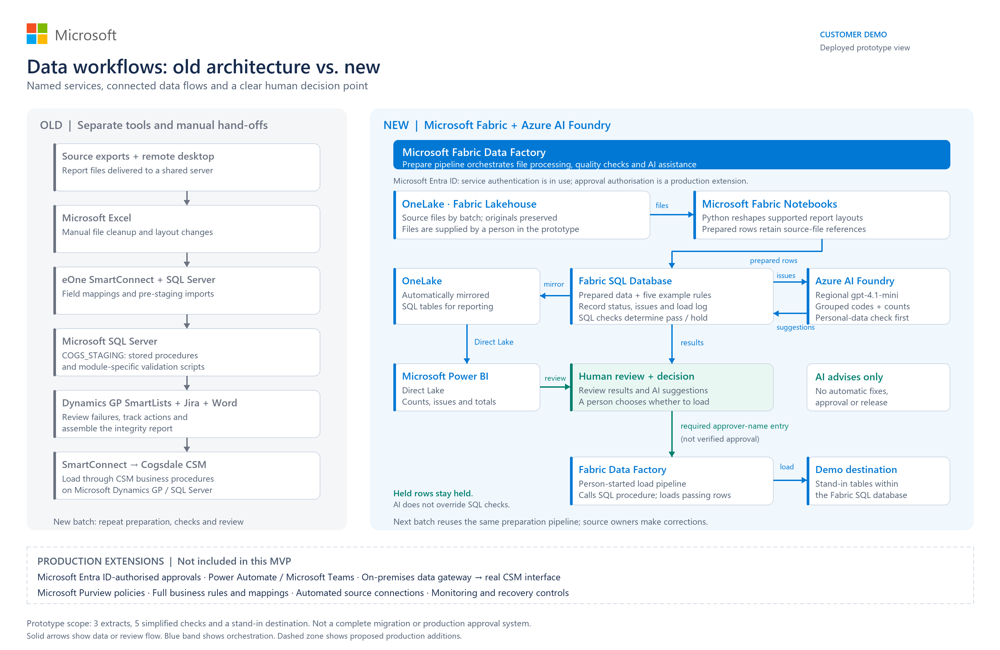

# Microsoft Fabric data-conversion platform

A deployable reference prototype for preparing legacy report extracts, validating staging data, using AI to explain issue groups, reviewing results and loading a **demonstration destination**.

This repository includes both the full conversion engine and the simplified customer demo. It does **not** include customer extracts, personal information, original project records, credentials, existing tenant/workspace settings or encrypted Office documents. Sample files are generated entirely from invented values.

> **Prototype, not a production CSM migration product.** The full engine contains an emulator of the destination procedure contracts; the MVP writes stand-in destination tables. Neither deploys Dynamics GP or the real Cogsdale CSM business application. Production integrations, complete customer-specific validation and authenticated business approvals remain delivery work.

## Choose a deployment

| Profile | Included |
|---|---|
| **MVP** (`conversion-mvp`) | Three extract types, four notebooks, five SQL quality checks, two pipelines, AI issue explanations, Direct Lake semantic model and two-page report. Start here for a capability demo. |
| **Full** (`conversion-platform`) | Five extract types, ten notebooks, one replay pipeline, 111 rule definitions, YAML mappings/crosswalks, source-file hashing and drift checks, cleansing proposals, six decision-gate records, destination-procedure emulator, reconciliation, generated reports and take-over-take comparison. |

The profiles use **separate workspaces and SQL databases**. They may share a capacity and regional Foundry deployment. Do not point them at an existing production database. SQL deployment/replay scripts can rebuild working tables and replace records for a batch.

### Architecture



- **OneLake / Lakehouse:** original input files; full engine also writes bronze, silver and `rpt_*` Delta tables.
- **Fabric notebooks:** Python preparation, validation orchestration, AI calls, load and reporting steps.
- **Fabric SQL Database:** staging, rule metadata, results and demonstration destination tables.
- **Azure AI Foundry:** regional GPT-4.1-mini deployment with structured JSON output and Entra authentication. AI requests use grouped issue metadata, not raw customer rows, and pass a personal-data check.
- **Fabric Data Factory:** preparation/replay pipelines and a separate person-started MVP load.
- **Power BI Direct Lake:** the MVP reads automatically mirrored SQL tables; the full model reads published lakehouse `rpt_*` tables.

The [offline click-through](docs/walkthrough.html) and [architecture PDF](docs/architecture.pdf) explain the capability story. Download the HTML and open it locally; GitHub does not execute it. Its illustrative measurements describe earlier prototype runs, **not** the small generated sample below.

## 1. Prerequisites

Use Python **3.11 or 3.12**. Deployment is documented from Windows PowerShell; the Python components and source checks also run on Linux.

Install:

- [Azure CLI](https://learn.microsoft.com/cli/azure/install-azure-cli).
- [Microsoft Fabric CLI](https://learn.microsoft.com/fabric/cicd/fabric-cli) (`python -m pip install ms-fabric-cli`).
- [Microsoft ODBC Driver 18 for SQL Server](https://learn.microsoft.com/sql/connect/odbc/download-odbc-driver-for-sql-server).
- Git. Node.js is not required.
- For the optional **local SQL smoke tests only**: SQL Server Express LocalDB on Windows. Fabric deployment does not require LocalDB.

In the recipient's tenant, provision these prerequisites through the Fabric and Azure portals:

1. An active Fabric capacity, with the required workloads enabled and adequate quota. Assign each demo workspace to that capacity. No particular SKU or cost is guaranteed by this repository.
2. For each selected profile, a **new workspace**, **Lakehouse**, and **Fabric SQL Database**. Use a schema-enabled lakehouse with the default `dbo` schema. Enable/verify SQL database mirroring for the MVP. Record the Fabric item IDs and the SQL server/database from its SQL connection string.
3. A **regional Azure AI Foundry / Azure OpenAI resource** and a `gpt-4.1-mini` model deployment supporting structured JSON output. The scripts use the resource endpoint `https://<resource>.cognitiveservices.azure.com/` and the Azure OpenAI chat-completions API. They do not use a Foundry project URL. Confirm regional model availability, quota and your data-residency requirements; do not substitute a Global deployment without redesigning the policy.
4. A deploying identity with Fabric workspace item-creation rights, Lakehouse write access, SQL schema/table/procedure creation and execution rights, Power BI model/report publishing rights, and **Cognitive Services OpenAI User** (or an appropriate equivalent) on the AI resource. Runtime notebook identities also need the corresponding data and model access. An administrator must grant these; this repository does not assign permissions.
5. Appropriate Power BI licences/capacity permissions for authors and viewers. If using the legacy model-check scripts, enable the tenant's Execute Queries API setting for the authorised identity.

This release deploys items into resources **you provision and configure**; it does not create a paid capacity or a Foundry resource, or modify cloud permissions. Network/firewall policies must allow the approved CLI, SQL, OneLake and AI connections. Check the target's collation before adapting the GP-compatible SQL; the local fixture uses `SQL_Latin1_General_CP1_CI_AS`.

## 2. Clone and install

```powershell
git clone https://github.com/vpsc95/fabric-data-conversion.git
Set-Location fabric-data-conversion
py -3.11 -m venv .venv
$py = ".\.venv\Scripts\python.exe"
& $py -m pip install -r requirements.txt
& $py -m pip install ms-fabric-cli
$env:PATH = "$PWD\.venv\Scripts;$env:PATH"
$env:PYTHONUTF8 = "1"
```

The examples below run from the repository root. Set `$py` again in a new shell. Fabric notebooks need the libraries in `requirements-fabric.txt`; both deployers add a dependency-check cell that installs missing packages. For restricted environments, arrange approved package availability in the notebook runtime first. Do not bypass package/network policies.

## 3. Configure your own environment

```powershell
Copy-Item deployment.example.json deployment.json
# Edit deployment.json using the resource settings you created above.
& $py tools\configure.py --profile both
```

Use `--profile mvp` or `--profile full` to configure only one. Replace every placeholder in the selected profile and the shared `tenant_id` / `foundry` section. Use the **Fabric SQL database item ID**, not its SQL analytics endpoint ID, for `sql_database_id`.

The configurator validates settings and writes:

- `conversion-mvp\workspace.json`
- `conversion-platform\fabric\workspace.json`

These files, `deployment.json`, local outputs and input files are gitignored. Never commit them. No passwords, API keys or client secrets are needed in configuration.

Authenticate interactively **in your own tenant**:

```powershell
$config = Get-Content deployment.json -Raw | ConvertFrom-Json
az login --tenant $config.tenant_id
fab auth login
```

Use Fabric CLI's interactive prompts to select the same tenant/identity. Confirm you can access the intended workspace before deploying. Azure CLI credentials are used by the Python deployment tools; notebooks obtain their runtime Entra tokens through `notebookutils`.

## 4. Generate safe sample input

```powershell
& $py tools\generate_sample.py
```

This creates `.local\synthetic\go-live` and `.local\synthetic\sim-take2`. Each contains **10 invented accounts, 20 services, 10 balances, 10 deposits and 20 meter readings**, in five files. There are no real people, contact details or credentials. The second batch corrects one state field and introduces one unknown service code.

The MVP consumes only customers, services and balances: **40 logical records and a balance total of 100.00**. Its `take-2` pipeline parameter maps to the generated `sim-take2` input folder.

Do not replace sample inputs with real data without completing your organisation's approved data-handling process. If Office protection makes a workbook unreadable to Python, stop and use an approved ingestion/export path; do not remove or bypass protection.

## 5A. Deploy and run the MVP

```powershell
# SQL objects, generated input files, notebooks and pipelines
& $py conversion-mvp\deploy.py all

# Prepare the first sample; this calls the regional AI deployment
& $py conversion-mvp\deploy.py run Prepare_take take_id=go-live

# Publish the semantic model, refresh it, and publish the bundled report
& $py tools\deploy_reports.py mvp
```

Wait for the preparation pipeline and SQL mirroring to complete before model/report deployment. `tools\deploy_reports.py` prints the resulting report link and records model/report IDs only in the ignored workspace file.

Review the results in Power BI, then explicitly run the demonstration load:

```powershell
& $py conversion-mvp\deploy.py run Approve_and_load take_id=go-live approved_by=demo-reviewer
& $py conversion-mvp\deploy.py run Prepare_take take_id=take-2
```

The approver field must be nonempty, but it is **not** a verified identity or digital signature. AI cannot authorise a load or release held records. The destination is `csm.*` tables **inside the MVP SQL database**, not the real application.

## 5B. Deploy and run the full platform

```powershell
# Engine, specs, SQL, tools and runtime configuration -> OneLake; then notebooks/pipeline
& $py conversion-platform\fabric\deploy.py all

# Upload the two generated samples into this profile's lakehouse
& $py conversion-platform\fabric\deploy.py landing .local\synthetic\go-live sample go-live
& $py conversion-platform\fabric\deploy.py landing .local\synthetic\sim-take2 sample sim-take2

# Deploy SQL and seed metadata, profile, reshape, validate, triage, load and publish
# --auto-approve is for this invented-data rehearsal only.
& $py conversion-platform\fabric\run_pipeline.py --client sample --take go-live --deploy-sql --require-ai --auto-approve

# The full model needs the rpt_* tables produced by the completed replay
& $py tools\deploy_reports.py full
```

For a demonstration of manual gates, omit `--auto-approve`:

```powershell
& $py conversion-platform\fabric\run_pipeline.py --client sample --take sim-take2 --require-ai --gate-timeout-minutes 30
```

The pipeline waits at the implemented load/publish gates. In a second authenticated shell, after reviewing the evidence:

```powershell
& $py conversion-platform\engine\run_local.py gates --target fabric --take sim-take2
& $py conversion-platform\engine\run_local.py approve --target fabric --take sim-take2 --gate 4 --by demo-reviewer --note "Reviewed sample load"
# After load/reconciliation, review again before approving publication:
& $py conversion-platform\engine\run_local.py approve --target fabric --take sim-take2 --gate 5 --by demo-reviewer --note "Reviewed sample reconciliation"
```

Other gates record mapping/spec review, cleansing proposals, AI triage decisions and take acceptance. They are prototype controls, **not a complete authorised approval system**. The runbook explicitly marks operations that require the real GP environment as simulated or waiting.

The sample profile does not carry a customer's historical answer key or sign-off. For production equivalence testing, supply an independently approved answer key and baseline in your controlled environment; the comparison utilities are included under `.github\skills\golden-master-test\scripts`.

### Re-deploying reports

Report/model creation fails rather than overwriting an existing same-name item by default. To update **your own** deployed demo definitions:

```powershell
& $py tools\deploy_reports.py mvp --update-existing
& $py tools\deploy_reports.py full --update-existing
```

The bundled PBIR definitions are directly deployable; no Copilot plugins, cached desktop files or report-builder CLI are required. Optional Python report builders and their theme are included for developers who change the visual layout.

## 6. Local checks and regression tests

No cloud credentials or customer data are required for these:

```powershell
& $py tools\check_release.py
& $py -m unittest discover -s tests -v
& $py .github\skills\gp-csm-sql-conventions\scripts\lint_tsql.py conversion-platform\sql
& $py .github\skills\conversion-spec\scripts\lint_spec.py conversion-platform\clients\sample --catalog conversion-platform\catalog\cogsdale-csm-gp\catalog.sample.json
```

CI runs the same checks on GitHub Actions. `check_release.py` checks tracked file types, syntax, configuration exclusions, credential patterns and the bundled PII scanner. It is a guardrail, not a guarantee that arbitrary future data is safe. The six existing mapping/catalog warnings are documented prototype gaps, not production-ready mappings.

With LocalDB and ODBC Driver 18:

```powershell
# Creates and removes its own uniquely named test database.
& $py tools\smoke_mvp.py

# Full end-to-end engine, no AI call in this local `all` command.
# This named database is retained so you can inspect results.
& $py conversion-platform\engine\run_local.py all --landing .local\synthetic\go-live --work .local\full-run --database ConversionDemoLocal --auto-approve
```

The MVP smoke test executes the real preparation code and SQL rules, rejects an empty approver, loads both synthetic batches and reconciles records and amounts. Full local `all` creates the emulator load, report files and gate records; `triage` and `map-draft` are separate AI-enabled commands requiring configured resources.

## Troubleshooting and operating boundaries

| Symptom | Check |
|---|---|
| Missing `workspace.json` | Run `tools\configure.py` for that profile. |
| Fabric/SQL/AI authentication error | Correct tenant in both CLI logins; rights for the actual runtime identity; network policy; regional model deployment and quota. |
| Missing notebook package | Use `requirements-fabric.txt` with an approved Python notebook package source/runtime. Both importers add a missing-package installation cell. |
| SQL database unavailable | Capacity is running; SQL is ready; ODBC connection server/database are correct. |
| Report table not found or empty | Run preparation/replay first. For MVP, wait for SQL mirroring; for full, verify the publish notebook created `rpt_*` lakehouse tables. Retry report deployment with `--update-existing` only for your own items. |
| Pipeline waiting | Inspect gates and evidence; record the relevant decision. Do not use auto-approval with customer production data. |
| PII gate rejects AI context | Investigate the metadata/context builder. Do not disable the gate or send raw rows to the model. |
| Source file layout changes | Add/review specs and tests. An unfamiliar layout is not automatically supported. |

Use a dedicated workspace per profile/customer and avoid overlapping takes: some working tables are rebuilt, not isolated for concurrent production runs. Keep files, output reports, logs and approval identities in controlled storage. Pause or resize your demo capacity when appropriate to manage costs; this repository does not change capacity state automatically.

## Delivery partner scope

Use this as a technical starting point, not a delivery completion claim. Production work includes full customer-specific mappings and rule verification, approved source integrations, destination CSM/GP procedure integration, authenticated approvals and separation of duties, data protection/retention, retries and recovery, concurrency controls, observability, performance testing and independent golden-master acceptance.

The repository intentionally excludes original customer workbooks and reports, personal correspondence, screenshots of deployed resources, local paths/settings, tokens and signed/encrypted Office artifacts. No production customer baseline has been published. Repository access does not grant rights to redistribute Microsoft/Cogsdale products or third-party business assets.
